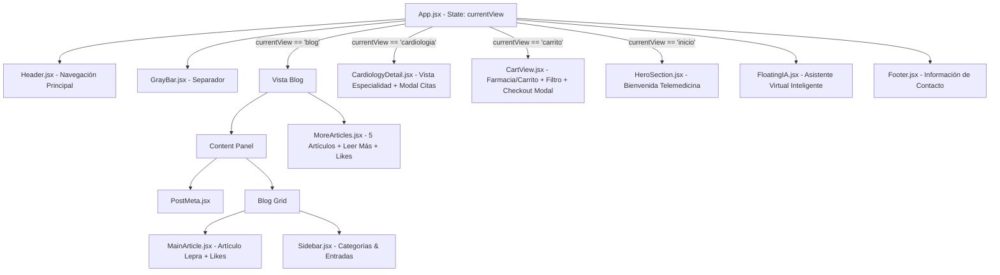

# 🏥 MEDLIFE - Virtual Healthcare (SPA React + Vite)

Bienvenido a la versión modernizada de **MEDLIFE Virtual Healthcare**, una **Single Page Application (SPA)** de alto rendimiento construida con **React 19** y **Vite 8**, migrada a partir de la maquetación estática original en HTML5, CSS3 y JavaScript.

---

## 📌 Tabla de Contenidos
1. [Descripción General](#-descripción-general)
2. [Arquitectura del Proyecto](#-arquitectura-del-proyecto)
3. [Estructura de Carpetas](#-estructura-de-carpetas)
4. [Componentes Desarrollados](#-componentes-desarrollados)
5. [Gestión de Estado y Persistencia](#-gestión-de-estado-y-persistencia)
6. [Infraestructura y Stack Tecnológico](#-infraestructura-y-stack-tecnológico)
7. [Instalación y Ejecución Local](#-instalación-y-ejecución-local)
8. [Verificación y Build de Producción](#-verificación-y-build-de-producción)
9. [Guía de Despliegue en Producción (Vercel)](#-guía-de-despliegue-en-producción-vercel)

---

## 📖 Descripción General
Este proyecto transforma la maqueta estática ubicada en `html-referencia/` en una aplicación modular, reactiva y mantenible bajo el paradigma de componentes de React. 

### Principios clave aplicados:
* **Fidelidad Visual 100% (Pixel-Perfect):** Se preservaron todas las clases CSS, paletas cromáticas originales, tipografías (`Montserrat`, `Poppins`, `Inter`, `Merriweather`), espaciados y media queries responsivas.
* **Sintaxis JSX Rigurosa:** Cierre estricto de todas las etiquetas (``, `<input />`, `<br />`), sustitución de atributos reservados (`class` ➔ `className`, `for` ➔ `htmlFor`), y renderizado seguro de SVGs en línea.
* **Interactividad Nativa con React Hooks:** Reemplazo de manipulaciones directas del DOM (`document.getElementById`, `innerHTML`) por hooks nativos (`useState`, `useEffect`) y persistencia en `localStorage`.

---

## 🏗 Arquitectura del Proyecto

La aplicación está diseñada como una Single Page Application con navegación dinámica entre vistas sin recarga de página:



---

## 📁 Estructura de Carpetas

```text
Melisa.proyecto.react/
├── html-referencia/             # Maquetación estática original intacta
│   └── Med_life-1/              # Archivos HTML, CSS y JS de referencia
├── public/                      # Recursos estáticos servidos directamente
│   ├── logo.png                 # Logotipo oficial de MEDLIFE
│   └── assets/
│       └── img/
│           ├── blog/            # Fondos y logotipos de sección blog
│           └── carrito/         # Assets de farmacia
├── src/
│   ├── assets/                  # Recursos gráficos importables
│   │   └── logo.png
│   ├── components/              # Componentes modulares e independientes
│   │   ├── CardiologyDetail.jsx # Vista detallada de Cardiología
│   │   ├── CartView.jsx         # Vista interactiva del Carrito de Farmacia
│   │   ├── FloatingIA.jsx       # Widget flotante interactivo de IA
│   │   ├── Footer.jsx           # Pie de página y canales de atención
│   │   ├── GrayBar.jsx          # Barra divisoria gris institucional
│   │   ├── Header.jsx           # Encabezado y barra de navegación
│   │   ├── HeroSection.jsx      # Pantalla de bienvenida e inicio
│   │   ├── MainArticle.jsx      # Artículo principal con botón de Like
│   │   ├── MoreArticles.jsx     # Grid con 5 artículos desplegables
│   │   ├── PostMeta.jsx         # Fecha, categoría e insignias SVG
│   │   └── Sidebar.jsx          # Menú lateral con accesos y categorías
│   ├── App.css                  # Estilos consolidados y optimizados
│   ├── App.jsx                  # Montaje central y enrutador SPA
│   ├── index.css                # Resets globales y tipografías
│   └── main.jsx                 # Punto de entrada de React 19
├── index.html                   # HTML base con fuentes de Google y FontAwesome
├── package.json                 # Dependencias y scripts de Vite
├── vite.config.js               # Configuración optimizada de Vite
└── README.md                    # Documentación técnica del proyecto
```

---

## 🧩 Componentes Desarrollados

| Componente | Archivo Fuente Original | Responsabilidad |
| :--- | :--- | :--- |
| **`Header.jsx`** | `blog.html` (`.site-header`) | Muestra el isotipo, nombre de marca y barra de enlaces con soporte para cambiar la vista activa en la SPA. |
| **`GrayBar.jsx`** | `blog.html` (`.gray-bar`) | Elemento estético de separación de secciones. |
| **`PostMeta.jsx`** | `blog.html` (`.post-meta`) | Indicadores de fecha de publicación y temática con iconos SVG vectoriales. |
| **`MainArticle.jsx`** | `blog.html` (`.post-body`) | Artículo principal "¿Qué es la lepra?". Incluye contador y alternancia de estado "Me Gusta" persistido en `localStorage`. |
| **`Sidebar.jsx`** | `blog.html` (`.sidebar`) | Lista de categorías de salud y enlaces directos con desplazamiento suave hacia cada artículo. |
| **`MoreArticles.jsx`** | `blog.html` (`.more-articles-panel`) | Catálogo interactivo con los 5 artículos adicionales (Asperger, Glaucoma, Vacunación, Corazón, Hipertensión). Cada tarjeta cuenta con toggle "Leer más / Leer menos" y Me Gusta individual. |
| **`FloatingIA.jsx`** | `blog.html` (`.ia-float-btn`) | Botón flotante animado que despliega un chat interactivo con el Asistente Virtual IA de Medlife. |
| **`CardiologyDetail.jsx`** | `cardiologia.html` | Vista de especialidad médica con grid de beneficios, llamada a la acción y modal de agendamiento de citas. |
| **`CartView.jsx`** | `carrito.html`, `carrito.js` | Carrito de compras de farmacia con buscador en tiempo real, selector de cantidades (+/-), cálculo dinámico en pesos colombianos (COP) y modal de confirmación. |
| **`HeroSection.jsx`** | `acceso.css` | Pantalla de inicio de bienvenida con botones de llamada a la acción hacia especialidades y blog. |
| **`Footer.jsx`** | `cardiologia.html` (`footer`) | Pie institucional con teléfono (+57 322 7048889), correo de contacto y derechos reservados. |

---

## 💾 Gestión de Estado y Persistencia

1. **Persistencia de "Me Gusta" (`medlife_blog_likes`):**
   - Se almacena un arreglo en `localStorage` con los identificadores de los posts a los que el usuario dio like (ej. `["lepra", "asperger"]`).
   - El estado persiste al recargar el navegador.
2. **Persistencia del Carrito de Compras (`medlife_cart`):**
   - Los productos, cantidades y precios se sincronizan con `localStorage` permitiendo conservar el pedido del usuario.
3. **Buscador Reactivo:**
   - Filtra productos en el carrito en tiempo real por nombre o marca mediante comparación en minúsculas.
4. **Acordeón de Lectura:**
   - Cada artículo de la sección secundaria gestiona de forma aislada su visibilidad completa mediante un mapa de estados booleanos en `useState`.

---

## ⚙️ Infraestructura y Stack Tecnológico

* **Frontend Framework:** [React 19](https://react.dev/)
* **Build Tool & Dev Server:** [Vite 8](https://vitejs.dev/)
* **Compilador JSX:** `@vitejs/plugin-react`
* **Linter de Código:** `oxlint`
* **Iconografía:** FontAwesome 6 (CDN) y SVGs vectoriales optimizados
* **Tipografías:** Google Fonts (`Montserrat`, `Poppins`, `Inter`, `Merriweather`)
* **Entorno de Ejecución:** Node.js v24+ / v20+ / v18+

---

## 🚀 Instalación y Ejecución Local

### 1. Clonar el Repositorio
```bash
git clone https://github.com/Melisa-arango/Melisa.proyecto.react.git
cd Melisa.proyecto.react
```

### 2. Instalar Dependencias
```bash
npm install
```

### 3. Iniciar el Servidor de Desarrollo
```bash
npm run dev
```
La aplicación estará disponible de inmediato en:
👉 `http://localhost:5173`

---

## 🧪 Verificación y Build de Producción

Para compilar la aplicación y generar los assets optimizados para producción (minificación de HTML, CSS y JS con soporte para caché HTTP):

```bash
npm run build
```

Salida esperada:
```text
✓ 28 modules transformed.
dist/index.html                   1.17 kB │ gzip:  0.57 kB
dist/assets/index-BNHw5amV.css   16.53 kB │ gzip:  4.11 kB
dist/assets/index-iKF84DOz.js   255.47 kB │ gzip: 78.87 kB
✓ built in <1s
```

Para previsualizar la compilación localmente antes del despliegue:
```bash
npm run preview
```

---

## ☁️ Guía de Despliegue en Producción (Vercel)

El proyecto está 100% preparado para ser desplegado en **Vercel** de forma directa:

1. **Subir los cambios a GitHub:**
   ```bash
   git add .
   git commit -m "feat: migración completa a React SPA con arquitectura modular y Vite"
   git push origin main
   ```
2. **Ingresar a Vercel:**
   - Abre [vercel.com](https://vercel.com/) e inicia sesión con tu cuenta de GitHub.
3. **Importar el Repositorio:**
   - Haz clic en **"Add New..."** ➔ **"Project"**.
   - Selecciona el repositorio `Melisa.proyecto.react`.
4. **Configuración del Proyecto:**
   - **Framework Preset:** `Vite` (Vercel lo detecta automáticamente).
   - **Root Directory:** `./` (la raíz del repositorio ya contiene `package.json`).
   - **Build Command:** `vite build`
   - **Output Directory:** `dist`
   - **Install Command:** `npm install`
5. **Desplegar:**
   - Haz clic en el botón **"Deploy"**.
   - En aproximadamente 30 segundos, Vercel entregará la URL pública (ejemplo: `https://melisa-proyecto-react.vercel.app`).
